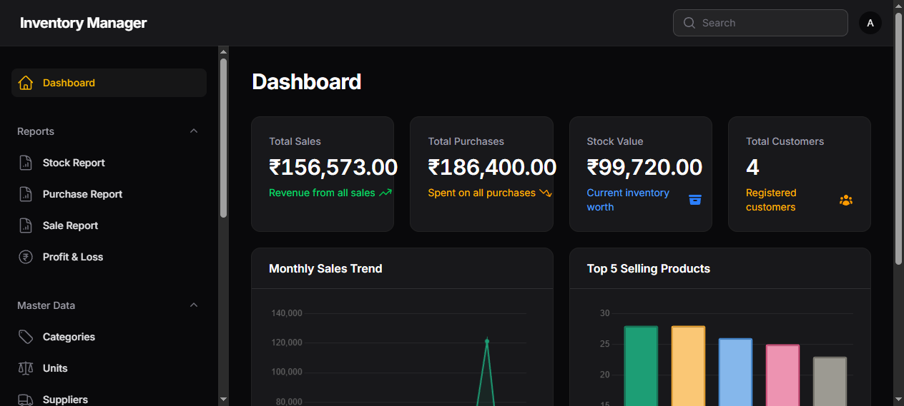
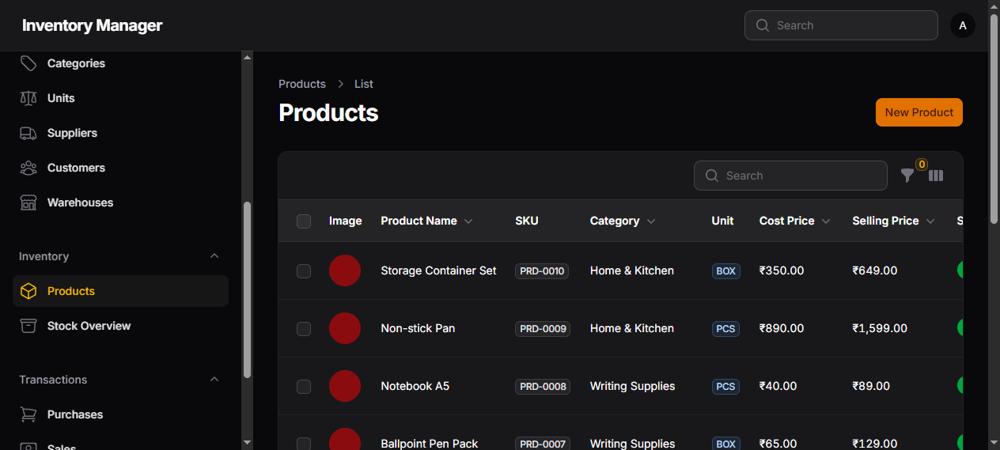
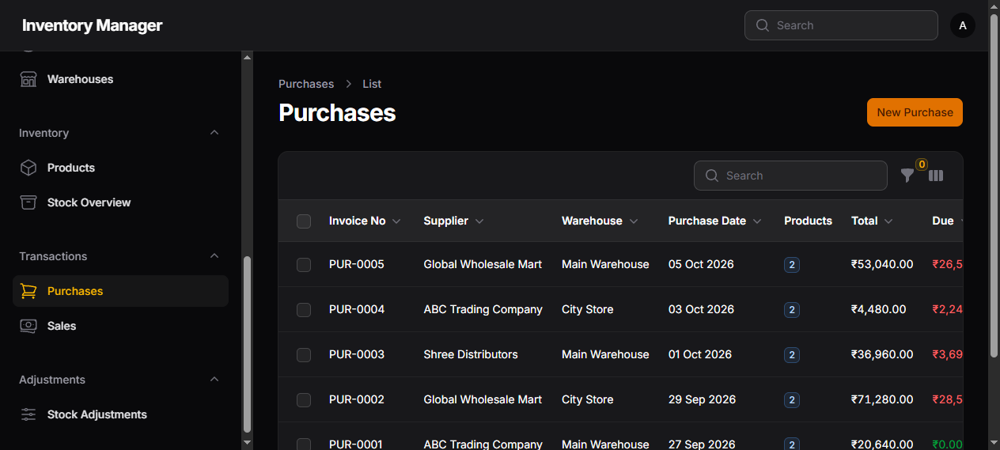
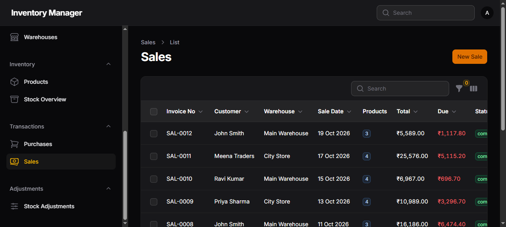
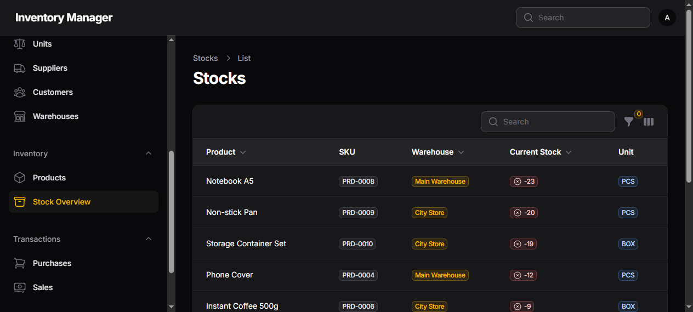
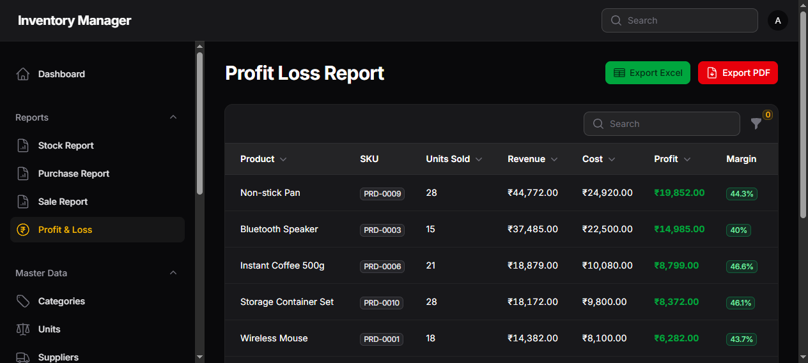
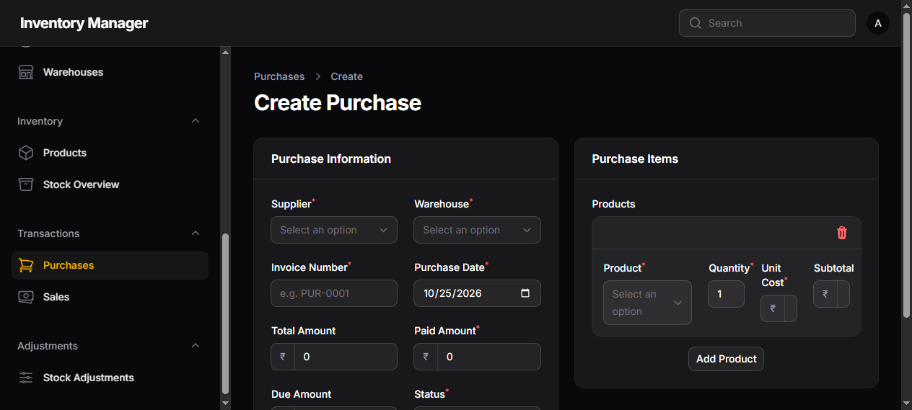

<div align="center">



# Laravel 13 · Filament 5 — Inventory Management System

Master data · Purchases · Sales · Stock Ledger · Adjustments · Reports (Excel/PDF)

[](https://github.com/katsugtgz/inventory-management/actions/workflows/ci.yml)
[](LICENSE)


[Features](#features) · [Screenshots](#screenshots) · [Quick Start](#quick-start-docker) · [Testing](#testing) · [Reports](#reports) · [Architecture](#architecture)

</div>

---

## Features

- **Master Data** — Categories (parent/child), Units, Suppliers, Customers, Warehouses
- **Inventory** — Products (image upload + rich editor), Stock Overview (read-only, low-stock alerts)
- **Transactions** — Purchases & Sales with Repeater line items, live subtotal calc, Infolist detail pages
- **Stock Ledger** — stock is **derived state**: model observers write movements; direct writes to the `stocks` table are rejected
- **Document Totals** — server-side derived via `recalculateTotals()`; never trusted from the client
- **Adjustments** — add/subtract with reason and adjusted-by stamp
- **Dashboard** — stat cards, monthly sales line chart, top-5 products bar chart
- **Reports** — Stock, Purchase, Sale, Profit & Loss — each with filters honored by Excel (xlsx) **and** PDF export

## Screenshots

| Dashboard | Products |
|:---:|:---:|
|  |  |

| Purchases | Sales |
|:---:|:---:|
|  |  |

| Stock Overview | Profit & Loss |
|:---:|:---:|
|  |  |

| Purchase form (Repeater + live totals) |
|:---:|
|  |

## Stack

| Package | Version |
|---|---|
| laravel/framework | 13.x |
| filament/filament | 5.x |
| livewire/livewire | 4.x (via Filament) |
| maatwebsite/excel | 4.x |
| barryvdh/laravel-dompdf | 3.x |
| laravel/sail | 1.x |
| PHP | 8.3+ (8.5 in Docker image) |
| MySQL | 8.4 |

## Quick Start (Docker)

```bash
docker compose up -d
```

Login at <http://localhost/admin> — `admin@example.com` / `password`

<details>
<summary>First-time setup (fresh clone only)</summary>

```bash
docker compose run --rm composer-sync composer install   # vendor/ into ext4 volume (fast on Windows)
docker compose exec laravel.test php artisan migrate --seed
docker compose exec laravel.test php artisan storage:link
docker compose exec laravel.test sh -c 'chown -R sail:sail storage bootstrap/cache'
docker compose exec laravel.test sh -c 'php artisan config:cache && php artisan route:cache && php artisan view:cache && php artisan event:cache && php artisan icons:cache'
```

</details>

> **Windows note:** `./vendor/bin/sail` rejects Git Bash/MinGW hosts. Use `docker compose` + `docker compose exec laravel.test php artisan ...` directly.

<details>
<summary>Performance on Windows bind mounts (~0.4–0.9s TTFB)</summary>

1. `infrastructure/zz-app-cli.ini` — opcache + realpath cache for the CLI server (mounted into the container)
2. `vendor-nodel` named volume — composer deps on ext4 instead of the Windows mount
3. `caddy` reverse proxy — gzip/zstd for all responses

After code changes: `php artisan optimize:clear` then re-run the cache commands.

</details>

## Testing

```bash
docker compose exec laravel.test php artisan test
```

CI (GitHub Actions) runs on every push/PR:

- **Pint** — code style, dry-run (`--test`)
- **Dry-run build checks** — `config:cache` / `route:cache` / `view:cache`
- **PHPUnit** — feature suite on PHP 8.4 / 8.5 against MySQL 8.4
- **Coverage** — clover + text report, uploaded as artifact

## Reports

Stock · Purchase · Sale · Profit & Loss — each report page supports filtering (date range, warehouse, category), and exports (**xlsx** via `maatwebsite/excel`, **PDF** via `barryvdh/laravel-dompdf`) honor the active filters.

## Architecture

- `app/Filament/Resources/**` — one directory per resource (Pages, Schemas, Tables)
- `app/Reports/**` — extracted query modules backing each report + its exports (exports are thin adapters)
- `app/Observers/**` — stock ledger automation: `PurchaseItemObserver`, `SaleItemObserver`, `StockAdjustmentObserver`
- `app/Filament/Pages/*Report.php` — report pages composing the query modules
- See [GLOSSARY.md](GLOSSARY.md) for domain terms

## Demo data

`InventoryDemoSeeder` seeds categories (parent/child), units, suppliers, customers, warehouses, products, purchases, sales and adjustments so every screen has data.

## License

[MIT](LICENSE)
